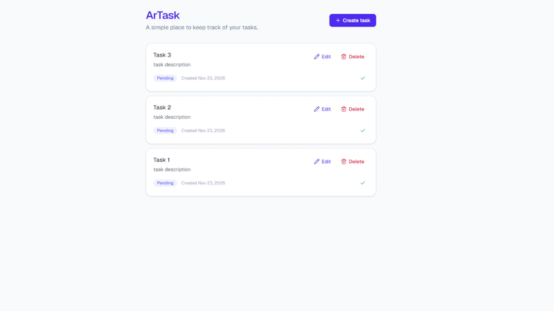
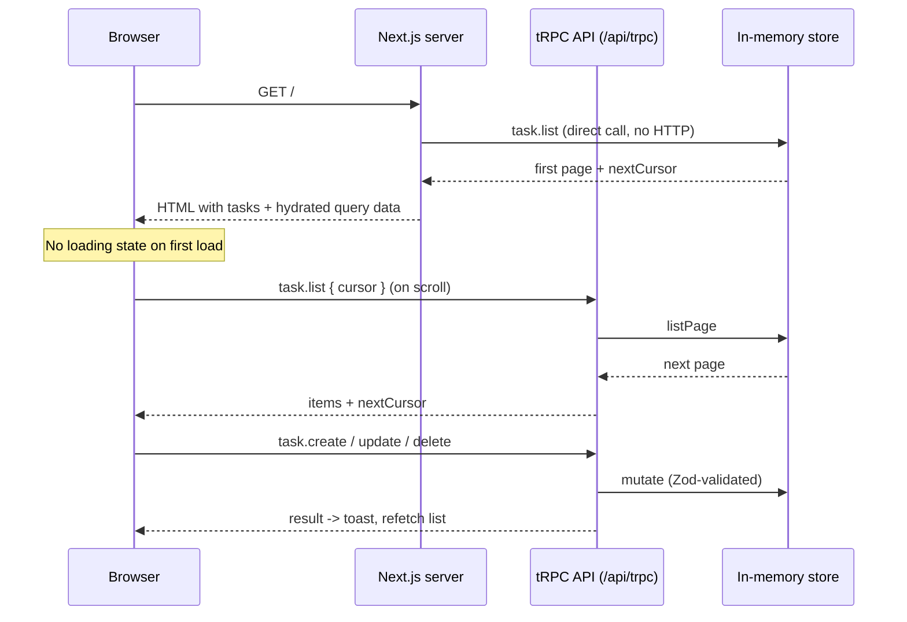

# ArTask

ArTask is a Next.js 15 app that simulates a task management application. The backend keeps the task list in memory and exposes it through tRPC.



## How it works



## Stack

- [Next.js 15](https://nextjs.org) (App Router) with React 19
- TypeScript
- Tailwind CSS
- tRPC, Zod and superjson
- ESLint, Prettier and Vitest

## Requirements

- Node.js 20 or newer
- pnpm (the version is pinned in `package.json`; `corepack enable` will pick it up)

## Getting started

```bash
pnpm install
pnpm dev
```

Then open http://localhost:3000.

## Scripts

| Command          | What it does                     |
| ---------------- | -------------------------------- |
| `pnpm dev`       | Start the dev server (Turbopack) |
| `pnpm build`     | Build for production             |
| `pnpm start`     | Run the production build         |
| `pnpm lint`      | Lint with ESLint                 |
| `pnpm typecheck` | Type-check with TypeScript       |
| `pnpm test`      | Run the tests with Vitest        |
| `pnpm format`    | Format the code with Prettier    |

## API

The tRPC API is served at `/api/trpc`. Tasks are kept in memory, so they reset whenever the server restarts.

A task has these fields:

| Field         | Type      | Notes                           |
| ------------- | --------- | ------------------------------- |
| `id`          | `string`  | UUID, generated by the server   |
| `title`       | `string`  | Required, 1 to 120 characters   |
| `description` | `string`  | Optional, up to 1000 characters |
| `completed`   | `boolean` | `false` when created            |
| `createdAt`   | `Date`    | Set when the task is created    |
| `updatedAt`   | `Date`    | Updated on every change         |

Procedures:

| Procedure      | Type     | Input                                      |
| -------------- | -------- | ------------------------------------------ |
| `task.list`    | query    | `{ limit?, cursor? }` (see below)          |
| `task.getById` | query    | `{ id }`                                   |
| `task.create`  | mutation | `{ title, description? }`                  |
| `task.update`  | mutation | `{ id, title?, description?, completed? }` |
| `task.delete`  | mutation | `{ id }`                                   |

Unknown ids return a `NOT_FOUND` error.

`task.list` returns one page of tasks, newest first, as `{ items, nextCursor }`. `limit` is 1 to 50 (default 10). To get the next page, send the `nextCursor` you received as `cursor`; it is `null` on the last page. The cursor is the id of the last task of the previous page, so tasks created or deleted in between do not shift the pages. A cursor whose task no longer exists returns `BAD_REQUEST`.

## Frontend

The home page (`/`) lists the tasks. It prefetches `task.list` on the server, so the first HTML already contains the first page of tasks, and hands that data to the client through TanStack Query hydration, so there is no loading state on first load. Each task can be deleted from the list; a toast confirms the deletion or shows the error.

The "Create task" button opens `/tasks/new`, and the "Edit" link on each task opens `/tasks/[id]/edit`. Both pages render the same `TaskForm` component; the edit page loads the task on the server and returns a 404 when it does not exist. In edit mode the form can also mark the task as completed, and clearing the description removes it.

The form validates on submit with the same Zod schema the server uses (`src/server/tasks/task.schema.ts`), so an invalid form never reaches the API. Errors are shown in one place each:

- Field errors, from the client check or from the server's Zod validation, appear under the field.
- The result of the request (created, updated, not found, network or server error) appears as a toast.

To create tasks without the UI, call the API directly:

```bash
curl -X POST http://localhost:3000/api/trpc/task.create -H 'content-type: application/json' -d '{"json":{"title":"Buy milk","description":"Whole milk"}}'
```

### Infinite scroll

The list loads 10 tasks at a time. The server renders only the first page; when the end of the list gets close to the screen, the next page is requested and added below.

- `src/server/tasks/task.store.ts` (`listPage`) returns a page and the cursor for the next one.
- `src/components/task-list.tsx` uses TanStack Query's `useSuspenseInfiniteQuery`, which keeps every loaded page and knows the next cursor.
- `src/hooks/use-load-more-on-visible.ts` watches an empty element below the last task with an `IntersectionObserver` and calls `fetchNextPage` when it comes into view.
- `src/app/page.tsx` prefetches the first page with the same options (`src/trpc/task-list.ts`), so the browser starts from the server's page.

Creating, editing or deleting a task refetches the loaded pages. To try it, create 30 tasks:

```bash
for i in $(seq 1 30); do curl -s -X POST http://localhost:3000/api/trpc/task.create -H 'content-type: application/json' -d "{\"json\":{\"title\":\"Task $i\"}}" > /dev/null; done
```
